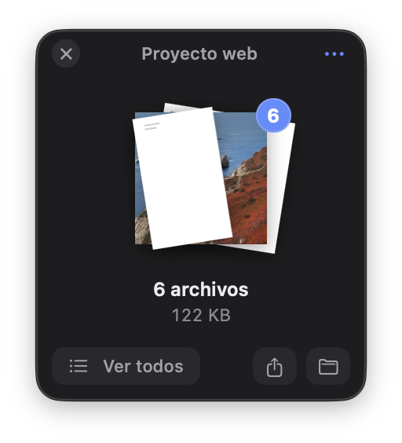
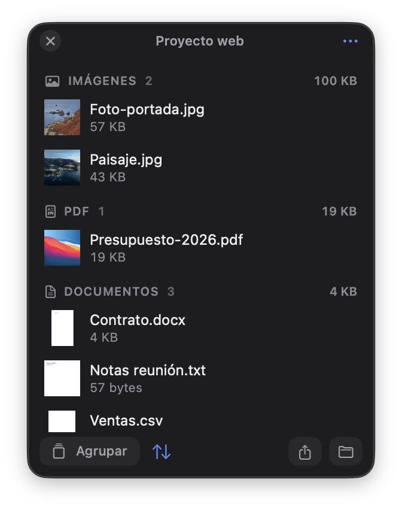
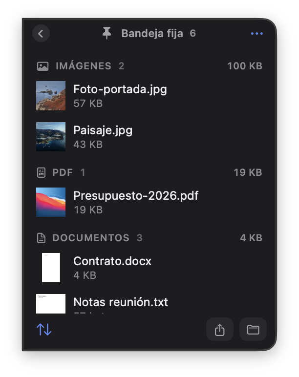
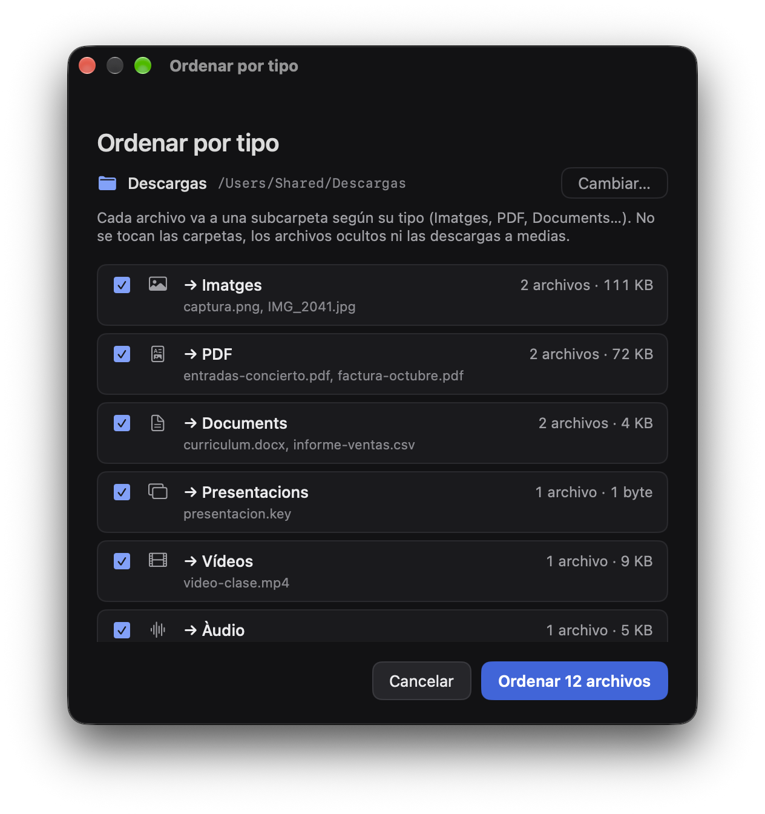
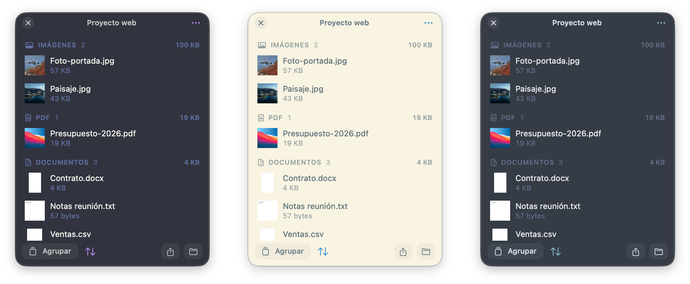
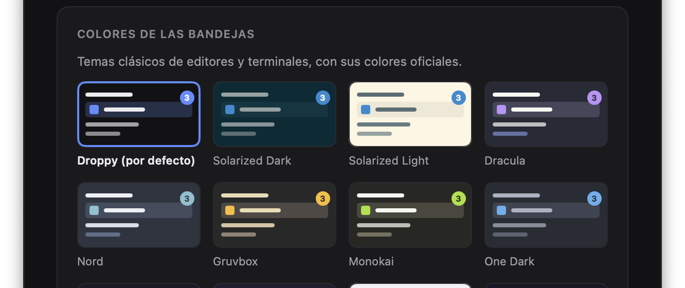

# Droppy

Bandejas flotantes para mover archivos en macOS. Empieza a arrastrar archivos, agita el ratón y aparece una **bandeja**: suéltalos ahí y esperan mientras cambias de carpeta, de app o de escritorio. Cuando tengas el destino a la vista, arrástralos desde la bandeja, todos a la vez o uno a uno. Como una lista de espera para mover cosas.

## Instalar

Abre Terminal y pega:

```sh
curl -fsSL https://raw.githubusercontent.com/drarekx/Droppy/main/install.sh | bash
```

El instalador descarga la última versión, la copia en `/Applications` y la abre. Droppy vive en la barra de menús (icono de bandeja); no sale en el Dock.

Droppy se actualiza sola: busca versiones nuevas al arrancar y una vez al día (o desde el icono → **Buscar actualizaciones…**), comprueba la descarga con su SHA-256 y se reinicia ya actualizada. Se puede desactivar en Ajustes. Volver a ejecutar el comando de instalación también actualiza.

**Instalación manual:** descarga `Droppy.zip` de [Releases](https://github.com/drarekx/Droppy/releases/latest), descomprímelo y mueve `Droppy.app` a Aplicaciones. La app no está notarizada, así que la primera vez ábrela con clic derecho → **Abrir**.

Requisitos: macOS 14 (Sonoma) o posterior. Apple Silicon o Intel.

## Para qué sirve

Mover archivos entre carpetas, apps o escritorios suele obligar a tener las dos ventanas a la vista a la vez. Con Droppy no: los dejas en una bandeja, vas a donde tengan que ir y los sueltas allí. Sirve también como sitio de paso para lo que estás reuniendo (las fotos y el presupuesto de un proyecto, lo que vas a adjuntar a un correo…) y para poner orden en Descargas.

## Cómo funciona

### 1. Agita el ratón mientras arrastras: aparece una bandeja

Empieza a arrastrar archivos desde el Finder (o texto, imágenes o enlaces desde cualquier app) y mueve el ratón a izquierda y derecha. Suéltalos en la bandeja: esperan ahí, flotando sobre las ventanas y en todos los escritorios, mientras cambias de carpeta o de app.

<p align="center"></p>

Cuando llegues al destino, **arrastra el montón** y te llevas todos los archivos. En el Finder, dentro del mismo disco se **mueven** (con ⌥ se copian, como siempre). Al sacarlos dejan la bandeja, y la bandeja vacía se cierra.

### 2. Uno a uno, ordenados y agrupados

«Ver todos» muestra la lista: cada archivo (o los seleccionados, con ⌘-clic o ⇧-clic) se arrastra por separado. Con el botón ⇅ se ordena por llegada, nombre, tamaño o tipo, y se agrupa por tipo con lo que ocupa cada grupo. Doble clic en la cabecera para **ponerle nombre**.

<p align="center"></p>

La bandeja solo apunta a los archivos, no los copia, y los sigue si los mueves en el Finder. El botón «…» y el clic derecho tienen el resto: abrir, vista rápida (Espacio), mostrar en Finder, copiar, copiar o mover a una carpeta, comprimir en ZIP, compartir, AirDrop, pasar a otra bandeja, quitar o mover a la papelera.

### 3. La bandeja fija, siempre en el borde

Una pestaña fina en el borde de la pantalla (izquierda o derecha; arriba, centro o abajo). Se abre al pasar el ratón, al arrastrar archivos hasta el borde, al agitar el ratón o con **⌃⌥D**, deslizándose desde el borde. Lo que dejes aquí **se queda** aunque lo arrastres a otro sitio, hasta que lo quites tú. Se pliega al apartar el ratón, con un clic fuera o con Esc.

<p align="center"></p>

### 4. Ordenar Descargas (o cualquier carpeta) por tipo

Desde el icono de la barra de menús → «Ordenar Descargas por tipo…», o con clic derecho sobre una carpeta de una bandeja. Antes de mover nada ves qué irá a cada subcarpeta y eliges los tipos. Las subcarpetas se llaman siempre igual, en catalán: `Imatges`, `PDF`, `Documents`, `Fulls de càlcul`, `Presentacions`, `Vídeos`, `Àudio`, `Comprimits`, `Instal·ladors`, `Codi`, `Apps` y `Altres`. No toca carpetas, archivos ocultos ni descargas a medias, y **Deshacer** lo deja todo como estaba.

<p align="center"></p>

En Ajustes se puede **ordenar automáticamente**: cada archivo nuevo que llega a la carpeta va a su subcarpeta cuando termina de descargarse. Los que ya estaban no se tocan. La primera vez macOS pide permiso para acceder a Descargas.

### 5. Colores de terminal

Temas clásicos con sus colores oficiales: Solarized (oscuro y claro), Dracula, Nord, Gruvbox, Monokai, One Dark, Tokyo Night, Catppuccin (Mocha y Latte), Rosé Pine, Everforest, Kanagawa y GitHub Dark, además del de Droppy.

<p align="center"></p>
<p align="center"></p>

## Todo lo que hace

- **Abrir una bandeja**: agitando el ratón mientras arrastras (sensibilidad baja, media o alta); pulsando ⌃, ⌥ o ⇧ mientras arrastras (desactivado por defecto); con **⌃⌥D**; soltando archivos en el icono de la barra de menús; con «Abrir con» → Droppy; con **Servicios → Add to Droppy**; o desde el icono, **Nueva bandeja** o **Nueva bandeja con lo copiado**. Con la bandeja fija activada, agitar, la tecla y ⌃⌥D abren la fija.
- **Qué se puede dejar**: archivos y carpetas, archivos prometidos (adjuntos de Mail, Fotos…), y texto, imágenes y enlaces, que se guardan como `.txt`, `.png` y `.webloc`. Se pueden tener varias bandejas a la vez.
- **Teclado** con la bandeja activa: Espacio (vista rápida), ⏎ (abrir), ⌘C, ⌘V, ⌘A, ⌫ (quitar seleccionados), ⌘⌫ (papelera), Esc / ⌘W (cerrar).
- **Nada se pierde**: las bandejas abiertas, la fija y las recientes se guardan en cada cambio y vuelven al abrir Droppy. La primera vez que se abre desde Aplicaciones se activa «Abrir al iniciar sesión» (se puede quitar en Ajustes), así que tras reiniciar el Mac vuelven solas. Una bandeja con nombre se guarda aunque esté vacía. Las que cierras con archivos van a «Bandejas recientes» en el menú del icono.
- **Idiomas**: castellano, inglés y catalán.

## Dónde guarda las cosas

- Bandejas (abiertas y recientes): `~/Library/Application Support/Droppy/shelves.json`
- Texto, imágenes y enlaces soltados: `~/Library/Application Support/Droppy/Clips/<id de la bandeja>/` (se borran al descartar la bandeja)
- Historial de ordenaciones (para deshacer): `~/Library/Application Support/Droppy/organize-history.json`
- Ajustes: `defaults read com.egluu.droppy`

## Desinstalar

```sh
osascript -e 'quit app "Droppy"'
rm -rf /Applications/Droppy.app ~/Library/Application\ Support/Droppy
defaults delete com.egluu.droppy
```

## Compilar desde el código

```sh
git clone https://github.com/drarekx/Droppy.git
cd Droppy
./build-app.sh          # deja build/Droppy.app y build/Droppy.zip
open build/Droppy.app
```

Con Xcode 16+ el binario es universal (arm64 + x86_64); solo con las Command Line Tools se compila para la arquitectura del Mac.

Para publicar una versión nueva, crea y sube una etiqueta; GitHub Actions compila la app y crea el release con el zip:

```sh
git tag v1.2.1 && git push origin v1.2.1
```
